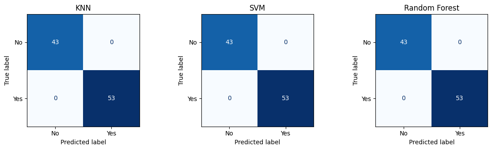
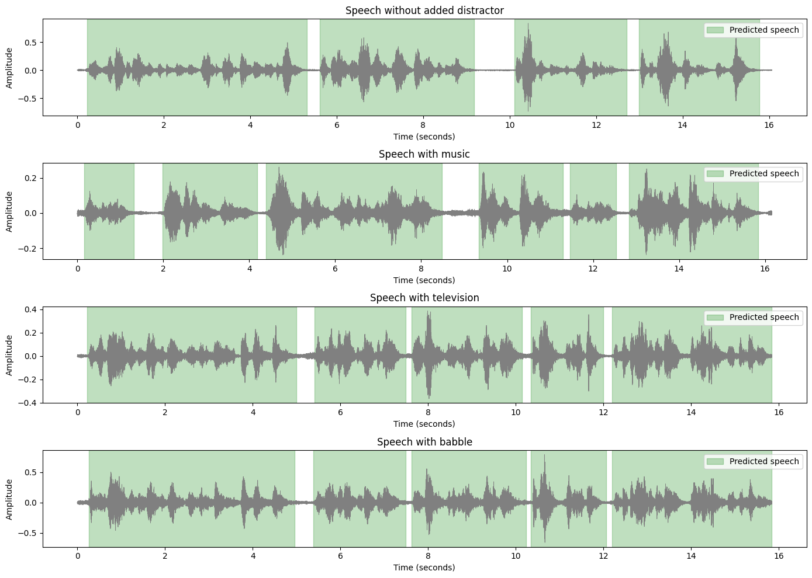
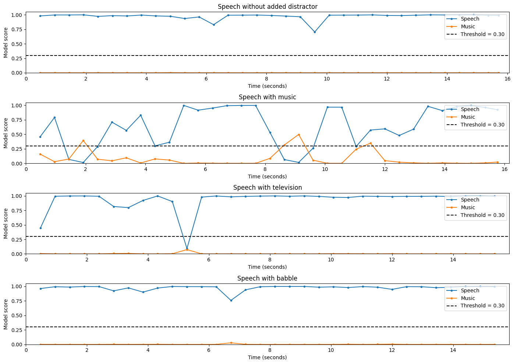

# Task 8: Yes/No Audio Classification and Audio Event Detection on VOiCES

**Student** — Muntadher Sadoon Kadhim  
**Student ID** — 404131088  
**Course** — Digital Speech Processing

**[Open Interactive Demo](https://markyou838-ctrl.github.io/digital-speech-processing/task8/index.html)** · [View Notebook](Audio_Assignment.ipynb) · [Browse CSV Results](results/)

## 1. Objective

This assignment has two parts. In the first, I trained and compared three classifiers on the YESNO dataset. In the second, I used the VOiCES subset to demonstrate voice activity detection with Silero VAD and audio event detection with YAMNet.

## 2. YESNO Word Classification

### Data preparation and segmentation

I started with 60 recordings from the torchaudio YESNO dataset. Each filename contains eight labels, where `0` means No and `1` means Yes. To train a word classifier, I first had to segment each recording into individual words and match each segment to its label in order.

I tested the segmentation across all recordings. Some adjacent words were merged into one segment, so I inspected the waveforms and adjusted the segmentation. I corrected one remaining recording manually. For another recording, I heard seven words while the filename provided eight labels. I excluded that recording because I could not reliably match the seven words to the eight labels.

After this check, I kept **59 recordings and 472 word samples**.

### Features and train/test split

For each word, I extracted 13 Mel-frequency cepstral coefficients (MFCCs). I calculated the mean and standard deviation of each coefficient over time, giving **26 features per word**.

I split the data by recording. This kept all words from each recording in the same set.

| Split | Recordings | Words | No | Yes |
| :--- | ---: | ---: | ---: | ---: |
| Training | 47 | 376 | 180 | 196 |
| Test | 12 | 96 | 43 | 53 |
| **Total** | **59** | **472** | **223** | **249** |

### Classifier results

I trained K-Nearest Neighbors (KNN), Support Vector Machine (SVM), and Random Forest on the same training set and evaluated them on the same test set.

| Classifier | Accuracy | Macro F1 | Correct / Total |
| :--- | ---: | ---: | ---: |
| KNN | 100% | 100% | 96 / 96 |
| SVM | 100% | 100% | 96 / 96 |
| Random Forest | 100% | 100% | 96 / 96 |

All three models correctly classified 43 No words and 53 Yes words. The results show that the MFCC features separated the two classes in this test split. The recordings came from one speaker, so the reported accuracy applies to held-out recordings from that speaker.

**Limitations of this part.** A majority-class baseline (always predicting Yes) would reach 53 / 96 = 55.2%, so the classifiers clearly learn something. However, all three models score perfectly, so this test cannot show which model is best. The test set is small (96 words), and a 96/96 result gives a 95% lower bound of about 96%. The test does not measure generalization to other speakers.

## 3. Voice Activity Detection on VOiCES

The VOiCES subset I downloaded contained **908 WAV files at 16 kHz**. I selected four recordings for the demonstration, one for each background condition. I used pretrained **Silero VAD** to estimate when speech was active in each recording.

| Background | Recording duration (s) | Predicted speech regions | Predicted speech duration (s) |
| :--- | ---: | ---: | ---: |
| No added distractor | 16.07 | 4 | 14.03 |
| Music | 16.16 | 6 | 13.48 |
| Television | 15.84 | 5 | 14.67 |
| Background babble | 15.84 | 5 | 14.80 |

The highlighted regions show when Silero predicted speech. For example, it marked six regions in the recording with music, covering 13.48 seconds. These durations summarize model predictions. Measuring VAD accuracy would require reference timestamps for speech.

**Observations.**
- The babble recording has the highest predicted speech share (93.4%). Silero may be counting the background voices as speech, so it cannot tell the target speaker apart from the babble. These results do not show which speech the model detects.
- In the recording without a distractor, the model marks about 87% as speech. The remaining ~2 seconds are probably short pauses, but this is not verified.

## 4. Audio Event Detection on VOiCES

I applied pretrained **YAMNet** to the same four recordings. I kept the **Speech** and **Music** scores, used a threshold of **0.30**, and grouped consecutive windows that met the threshold into approximate event intervals.

In the recording with music, YAMNet detected three music intervals.

| Music interval | Start (s) | End (s) | Peak score |
| :--- | ---: | ---: | ---: |
| 1 | 1.44 | 2.40 | 0.394 |
| 2 | 8.16 | 9.60 | 0.498 |
| 3 | 11.04 | 12.00 | 0.348 |

Speech and music can overlap because YAMNet scores the two classes separately. In the interactive demo, changing **Background** selects a different recording and updates the VAD summary, event timeline, and interval table.

**Observations.**
- The three music intervals cover about 3.4 seconds of the 16.2-second recording. If music plays for the whole recording, as the background name suggests, YAMNet misses most of it. Its highest music score is only 0.50, so the model is not confident. I have not verified this by listening or with reference labels.
- In the other three recordings, the music score stays below 0.08, so there are no false music detections there.
- Each YAMNet window is 0.96 seconds long, so the intervals can extend up to about half a second on each side. Pauses shorter than about one second are merged into one speech interval. This is why the recording without a distractor appears as one continuous speech interval, while Silero finds four separate regions.
- The TV and babble backgrounds have no matching class in this test, so the event detection does not check whether those backgrounds are present.

## 5. Conclusion

The three YESNO classifiers gave the same result on the test set, which shows the task is easy for these features. Checking the segmentation was important because a merged or missing word can shift the labels for the following segments.

On VOiCES, this work is a qualitative demonstration on four recordings. Silero VAD and YAMNet produce plausible outputs, but I have **not measured their accuracy**, because the recordings have no reference labels. The results should be read as examples of model behavior, not as performance measurements.

## 6. Next Steps

- Create reference labels for speech and music in a larger set of recordings, then compute precision, recall and F1 for both VAD and event detection.
- Compare Silero VAD with a simple energy-based VAD or WebRTC VAD as a baseline.
- Plot precision-recall curves to choose the YAMNet threshold on separate validation data, instead of using 0.30.
- For YESNO, repeat the split with several random seeds, and try a small neural network in PyTorch on mel-spectrograms.

## 7. How to Run

1. Download [the notebook](Audio_Assignment.ipynb) and upload it to Google Colab.
2. Run the cells from top to bottom. The notebook downloads YESNO and the VOiCES subset, and it needs internet access.
3. Open the [interactive demo](https://markyou838-ctrl.github.io/digital-speech-processing/task8/index.html) to explore the saved results, or browse the [CSV files](results/) for the exported tables.
